<div align="center">


# Beekeeper

**A voice-first desktop assistant for Windows that understands Indian English and Hindi.**<br>
Press a hotkey and talk, dictate into any app, circle anything on your screen, or capture it in a Samsung-style studio.
Human-sounding voice, private by default, works offline.

[](https://github.com/snowjug/Beekeeper/actions/workflows/ci.yml)
[](https://github.com/snowjug/Beekeeper/releases/latest)
[](LICENSE)


### [⬇ Download for Windows](https://github.com/snowjug/Beekeeper/releases/latest)

<sub>Installer (`Beekeeper-Setup-1.1.1.exe`) or portable (`Beekeeper-Portable-1.1.1.exe`) · 64-bit · unsigned, see [SmartScreen](#install)</sub>

</div>

<br>

<p align="center">
  
</p>

## Highlights

- **A voice that sounds human.** Replies are spoken by an on-device neural voice ([Supertonic 3](https://huggingface.co/Supertone/supertonic-3),
  ten voices, English and Hindi) instead of the robotic Windows voice. No cloud, no account; an optional
  [ElevenLabs](https://elevenlabs.io) voice is available if you bring your own key.
- **It understands your accent and Hindi.** Speech recognition runs on-device with [Whisper](https://github.com/openai/whisper)
  (small or base), detects English or Hindi on its own and copes with Hinglish ("volume badha do",
  "कल सुबह सात बजे का अलार्म लगाओ"). Hindi commands are answered in Hindi.
- **One hotkey, one bar.** `Ctrl+Shift+Space` springs a glass assistant bar up on the display you are working on, in
  about 40 ms. Type, or just talk; push-to-talk and an optional **"Hey Beekeeper"** wake word are built in.
- **Dictation anywhere.** `Alt+Shift+D`, speak in English, Hindi or both, and Beekeeper types the text into whatever app has
  the cursor - with spoken punctuation ("comma", "new line", "पूर्ण विराम").
- **Capture Studio.** `Alt+Shift+S` takes a screenshot and opens a glowing, Samsung-style preview: crop, draw, blur,
  **pin to screen**, copy, share, save, set as wallpaper, extract the text or hide sensitive information automatically.
- **Circle to Search for your whole desktop.** `Alt+Shift+C` freezes the screen, you draw a glowing lasso around anything,
  and Beekeeper reads it (offline OCR) and offers copy, search, translate, **read aloud** and more.
- **Daily briefing.** "Good morning" gives you the date, the weather, today's reminders and timers and how many notes you saved,
  spoken aloud.
- **30+ commands** for apps, the web, information, productivity and Windows itself - with typo-tolerant, synonym-aware
  phrasing and follow-ups ("what about tomorrow?").
- **Premium, calm UI.** Spring physics, Mica, 60 fps transform-only animation, full keyboard navigation, screen-reader
  announcements and a reduced-motion mode.
- **Private by default.** No account, no telemetry, nothing leaves your PC unless you ask for something that needs the
  internet (weather, a definition, a one-time model download) or switch on the optional cloud features. See
  [PRIVACY.md](PRIVACY.md).

<table>
  <tr>
    <td width="50%"><br><sub><b>Weather</b> - live card with a 7-day forecast and animated icons.</sub></td>
    <td width="50%"><br><sub><b>"What can you do?"</b> - every command with an example you can click.</sub></td>
  </tr>
</table>

### Natural voice, Hindi and your accent

Beekeeper runs two small neural models **on your PC** (no cloud): a text-to-speech voice and Whisper for recognition. They are
downloaded once from the first-run tour (or Settings > Voice) and verified against pinned SHA-256 checksums:

| Model                                | Size    | What it gives you                                                                       |
| ------------------------------------ | ------- | --------------------------------------------------------------------------------------- |
| Natural voice (Supertonic 3)         | ~129 MB | Ten human-sounding voices, English **and Hindi**, speed control, sentence-by-sentence   |
| Accurate recognition (Whisper small) | ~375 MB | Indian-accented English, Hindi and Hinglish, automatic language detection (recommended) |
| Fast recognition (Whisper base)      | ~160 MB | Quicker, fine for clear English; Hindi is rougher                                       |
| Light offline model (Vosk)           | ~40 MB  | The small 1.0 recogniser (English), still available; it is also used for the wake word  |

The models are loaded when you start talking and **released after three idle minutes**, so an idle Beekeeper stays small.
Prefer the cloud? In Settings > Voice you can choose Azure or **ElevenLabs** (your own API key and voice ID).

Say things the way you speak: _"What's the weather in Mumbai tomorrow?"_ · _"मुंबई में कल मौसम कैसा रहेगा?"_ ·
_"5 मिनट का टाइमर लगाओ"_ · _"chrome kholo"_ · _"आवाज़ बढ़ाओ"_. Hindi replies are spoken in Hindi.

<table>
  <tr>
    <td width="50%">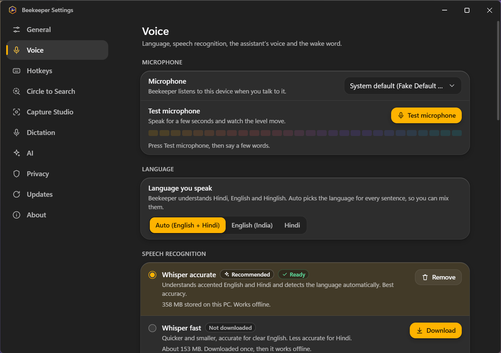<br><sub><b>Language and recognition</b> - Auto (English + Hindi), English (India) or Hindi; Whisper accurate or fast, each with its download state.</sub></td>
    <td width="50%">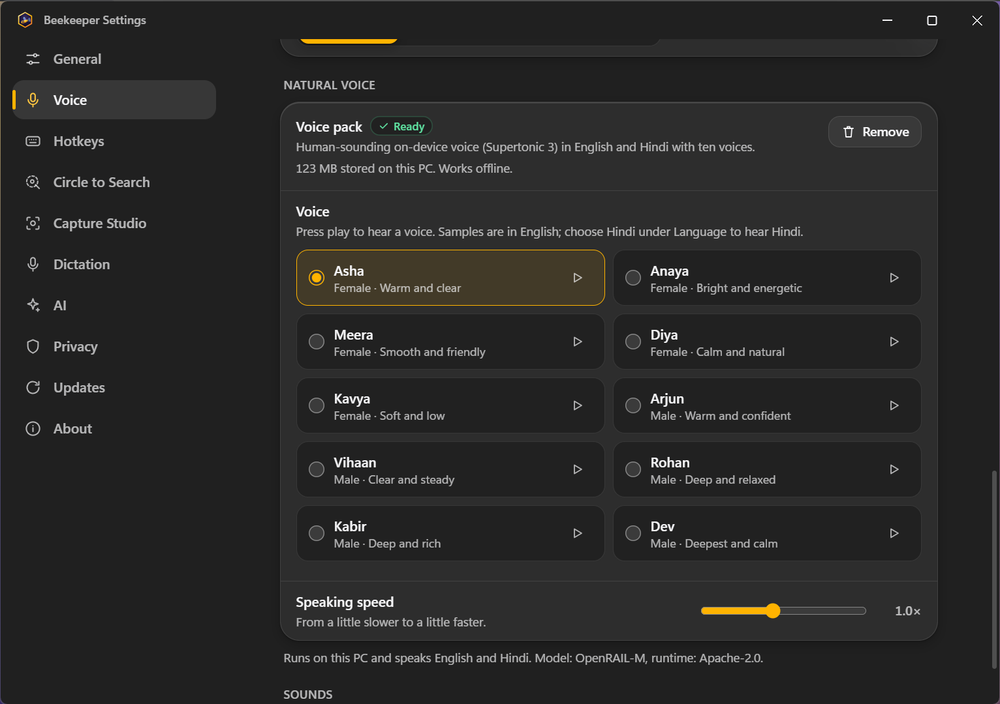<br><sub><b>Ten natural voices</b> - press play to hear each one, then set the speaking speed.</sub></td>
  </tr>
</table>

### Capture Studio

<p align="center">
  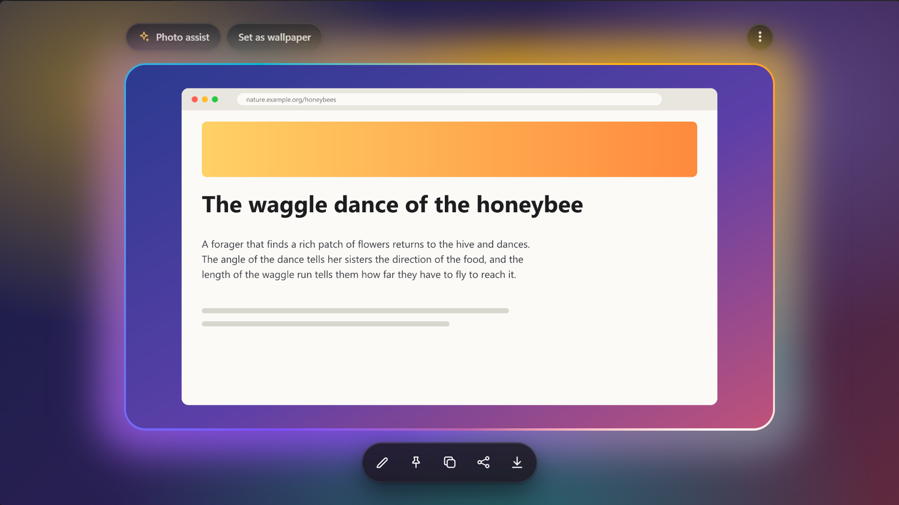
</p>

`Alt+Shift+S` (or "take a screenshot") captures the display under the mouse and opens a glowing preview: the picture floats
in a soft gradient glow whose colours drift around it like liquid light (a ribbon of light circles the border as it opens;
there are no hard edges or corner marks, and the glow can be turned off or left still with reduced motion), with **Photo
assist** (extract the text, or **hide sensitive information** such as
e-mail addresses, phone numbers and card numbers with one click), **Set as wallpaper**, and a toolbar with **Edit** (crop,
pen, highlighter, arrow, shapes, text, blur), **Pin to screen** (an always-on-top copy you can drag, zoom with the wheel and
make see-through with `Ctrl` + wheel), **Copy**, **Share** (copy as file, open with, e-mail, show in folder) and **Save**
(`Pictures\Beekeeper`, or the folder you choose; automatic saving can be turned off).

<table>
  <tr>
    <td width="50%">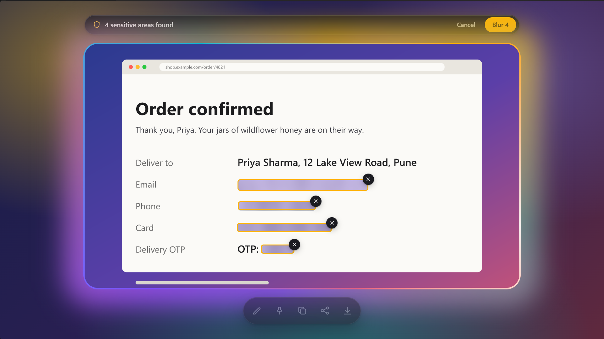<br><sub><b>Hide sensitive info</b> - e-mail addresses, phone numbers, card numbers, ID numbers, one-time codes and keys are found on your PC; you review the boxes and press <i>Blur</i>.</sub></td>
    <td width="50%">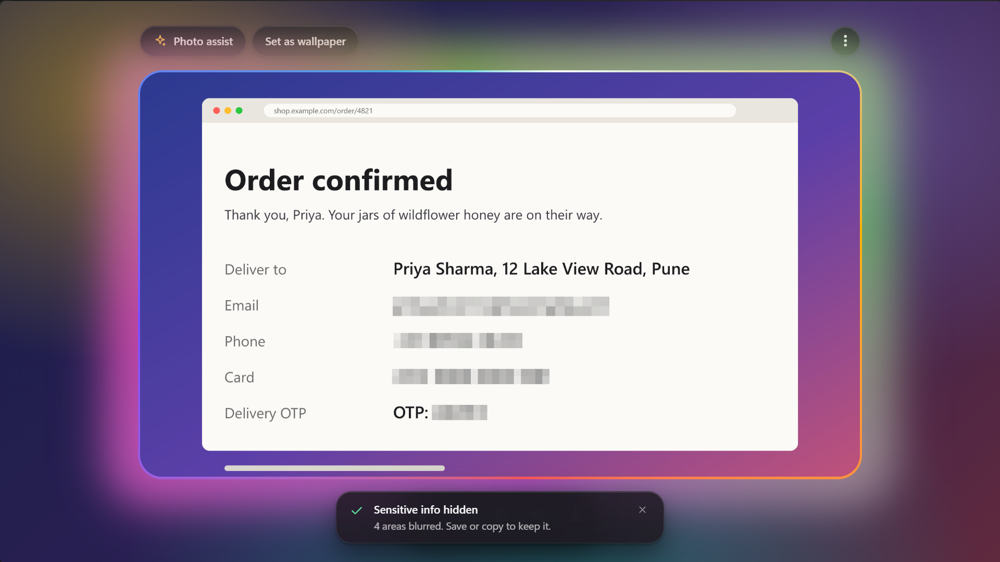<br><sub><b>One click later</b> - the blurred picture is what you copy, pin, share or save. The original capture is never overwritten.</sub></td>
  </tr>
  <tr>
    <td width="50%">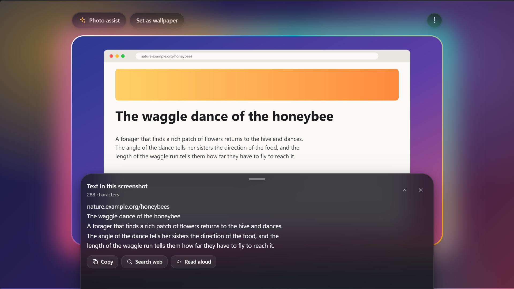<br><sub><b>Extract text</b> - the words in the picture (offline OCR), ready to copy, search or read aloud.</sub></td>
    <td width="50%">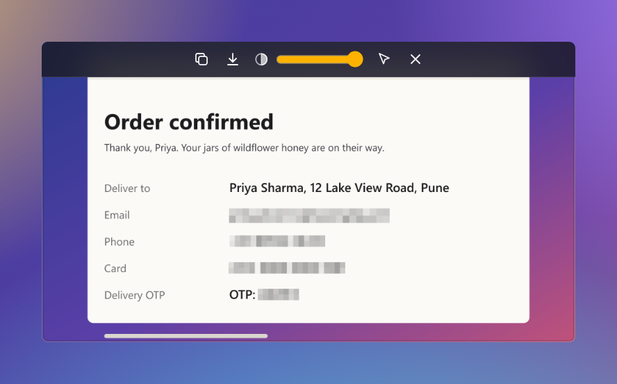<br><sub><b>Pin to screen</b> - keep a picture in view while you work; hover for copy, save, opacity, click-through and close.</sub></td>
  </tr>
</table>

### Dictation anywhere

Put the cursor in any app (Notepad, Word, Chrome, Teams ...), press `Alt+Shift+D`, and talk. A small pill shows that it is
listening; when you pause, the text is typed for you - English, Hindi or a mix. Say "comma", "full stop", "question mark",
"new line" (or the Hindi equivalents) to punctuate. If you switch windows meanwhile, or the target app runs as administrator,
the text is copied to the clipboard instead of being typed into the wrong place.

<table>
  <tr>
    <td width="50%">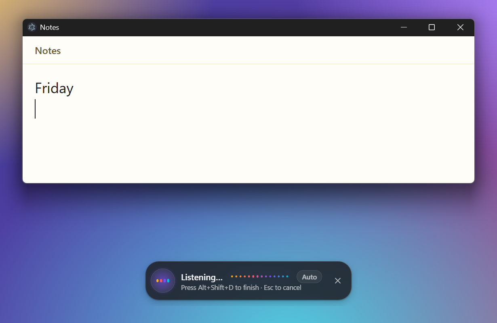<br><sub>The pill never takes the keyboard focus from the app you are typing into.</sub></td>
    <td width="50%">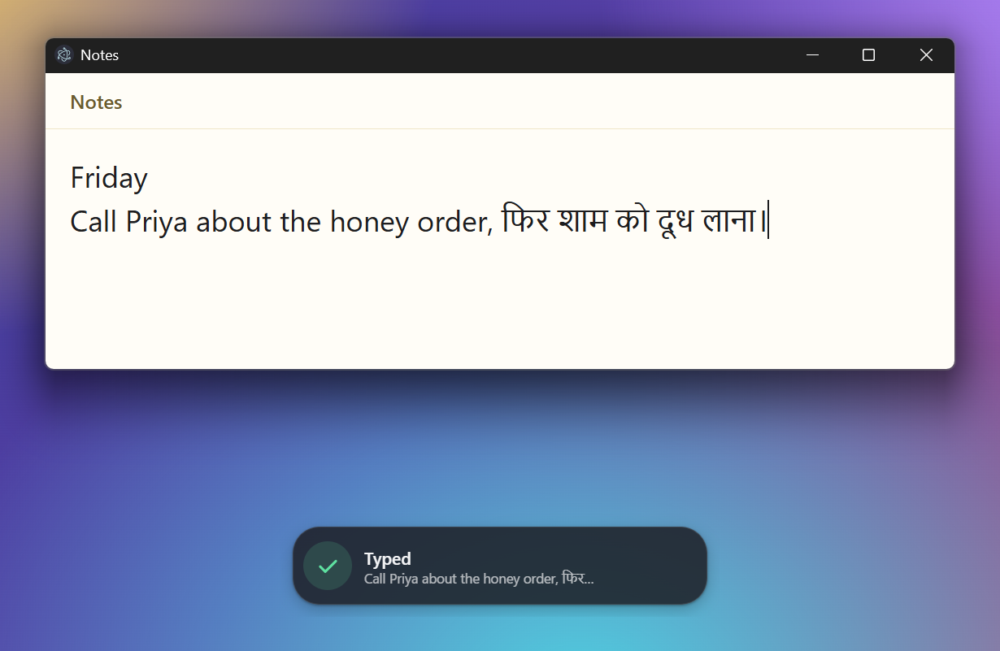<br><sub>"call Priya about the honey order comma फिर शाम को दूध लाना full stop" becomes punctuated text.</sub></td>
  </tr>
</table>

### Circle to Search

<p align="center">
  
</p>

Draw a lasso (it glows and morphs into a selection box), **tap** a word, **double-tap** a line, hold **Shift** to drag a
rectangle, or use the keyboard (`Enter` starts a selection, arrow keys move it, `Shift` + arrows resize it). The text is recognised on your PC; links, e-mail addresses, phone
numbers, dates and maths get their own actions, and the picture can be searched, copied or saved. **Speak** reads the
selection aloud with the natural voice. With Azure OpenAI
configured you can also **ask about the selected image**. `Esc` cleans everything up.

### Settings and first run

<table>
  <tr>
    <td width="50%"><br><sub>Settings apply instantly - there is no Save button.</sub></td>
    <td width="50%"><br><sub>A five-step first-run tour: welcome, language and voice, microphone, hotkeys, done.</sub></td>
  </tr>
  <tr>
    <td colspan="2" align="center">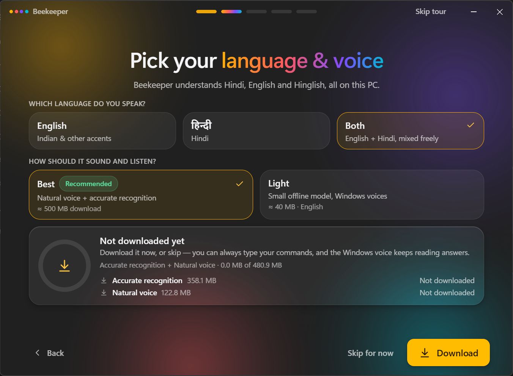<br><sub>Pick English, Hindi or both, then download the natural voice and accurate recognition (Best) or the small English model (Light).</sub></td>
  </tr>
</table>

## Hotkeys

| Hotkey                        | What it does                                                                                              |
| ----------------------------- | --------------------------------------------------------------------------------------------------------- |
| `Ctrl` `Shift` `Space`        | Open the assistant bar and start listening (press again to close). With push-to-talk on, hold it to talk. |
| `Alt` `Shift` `C`             | Circle to Search on the display under the mouse.                                                          |
| `Alt` `Shift` `S`             | Capture Studio: screenshot of the display under the mouse with the glowing preview.                       |
| `Alt` `Shift` `D`             | Dictation anywhere: speak and the text is typed into the focused app (press again to finish).             |
| `Enter` · `Up` / `Down`       | Send the text · recall earlier requests.                                                                  |
| `Esc`                         | Stop speaking / listening, close the bar, leave Circle to Search, Capture Studio or dictation.            |
| Wake word **"Hey Beekeeper"** | Off by default. Turn it on in Settings > Voice (needs the light offline model).                           |

All four global hotkeys can be changed in **Settings > Hotkeys**. If another program already owns a combination, Beekeeper says
so and suggests a free alternative.

## What you can say

Type or speak. Anything that is not a command goes to your AI (if you configured Azure OpenAI) or opens a web search.

| #   | Command                     | Try saying                                                                    |
| --- | --------------------------- | ----------------------------------------------------------------------------- |
| 1   | Open an app                 | "Open Notepad" · "Launch VS Code" · "Start Spotify" · "Open task manager"     |
| 2   | Close an app                | "Close Notepad" · "Quit Chrome" (graceful; asks before forcing)               |
| 3   | Search the web              | "Search for cats" · "Google best pizza" · "Bing weather in Paris"             |
| 4   | Play on YouTube             | "Play despacito on YouTube" · "YouTube lofi beats"                            |
| 5   | Open a website              | "Open github.com" · "Go to example.org"                                       |
| 6   | Time & date                 | "What time is it?" · "What's the date?" · "What time is it in Tokyo?"         |
| 7   | Weather                     | "Weather in Paris" · "Will it rain tomorrow?" (7-day animated card)           |
| 8   | Battery                     | "Battery status" · "Is my laptop charging?"                                   |
| 9   | System info                 | "System info" · "How much RAM do I have?" · "How long has my PC been on?"     |
| 10  | Calculator                  | "Calculate 15% of 2400" · "Square root of 144" · "2^8" (safe parser)          |
| 11  | Unit converter              | "Convert 5 km to miles" · "100°F to celsius" · "10 pounds in kg"              |
| 12  | Dictionary                  | "Define serendipity" · "What does ephemeral mean?"                            |
| 13  | Timers                      | "Set a timer for 5 minutes" · "Cancel my timer" (several at once)             |
| 14  | Reminders                   | "Remind me in 10 minutes to call mom" · "Remind me at 3:30 pm to ..."         |
| 15  | Alarms                      | "Set an alarm for 7 am" · "Wake me up at 6:30"                                |
| 16  | Notes                       | "Take a note buy milk" · "Show my notes" · "Delete last note"                 |
| 17  | Copy that                   | "Copy that" (copies the last answer)                                          |
| 18  | Volume                      | "Volume up" · "Mute" · "Set volume to 40%"                                    |
| 19  | Brightness                  | "Brightness down" · "Set brightness to 70%"                                   |
| 20  | Screenshot                  | "Take a screenshot" (opens Capture Studio; saved to `Pictures\Beekeeper`)     |
| 21  | Lock                        | "Lock my PC"                                                                  |
| 22  | Windows settings            | "Open Wi-Fi settings" · "Bluetooth settings" · "Sound settings"               |
| 23  | Empty the Recycle Bin       | "Empty the recycle bin" (asks first)                                          |
| 24  | Shut down / restart / sleep | "Restart" · "Shut down" · "Sleep" (always asks, with a 10 s cancel countdown) |
| 25  | Dark mode                   | "Toggle dark mode" · "Switch to dark mode"                                    |
| 26  | Circle to Search            | "Circle to Search" · "Search my screen"                                       |
| 27  | Settings & help             | "Open settings" · "What can you do?"                                          |
| 28  | Stop                        | "Stop" · "Never mind" · "Cancel"                                              |
| 29  | Dictation                   | "Start dictation" · "Type what I say" (then talk; same as `Alt+Shift+D`)      |
| 30  | Daily briefing              | "Good morning" · "Brief me" · "What does my day look like?"                   |
| 31  | Repeat                      | "Repeat that" · "Say that again" · "What did you say?"                        |
| 32  | Anything else               | Streaming answer from **Azure OpenAI** if configured, otherwise a web search  |

Reminders and timers survive a restart and fire if they are still due.

### In Hindi and Hinglish

The same commands work in Hindi (Devanagari), Hinglish (Hindi in Roman letters) and mixed sentences; replies come back in Hindi
and are spoken with the Hindi voice. These phrases were checked against the real command engine:

| You say                                            | Beekeeper does                 | It answers (in Hindi)                     |
| -------------------------------------------------- | ------------------------------ | ----------------------------------------- |
| "मौसम कैसा है" · "mausam kaisa hai"                | Weather                        | the temperature and sky, in Hindi         |
| "5 मिनट का टाइमर लगाओ" · "5 minute ka timer lagao" | Starts a 5-minute timer        | "ठीक है, 5 मिनट का टाइमर शुरू कर दिया।"   |
| "कल सुबह सात बजे का अलार्म लगाओ"                   | Alarm for 7 am tomorrow        | "अलार्म कल सुबह 7 बजे के लिए सेट हो गया।" |
| "यूट्यूब खोलो" · "chrome kholo" · "ओपन क्रोम"      | Opens YouTube / Chrome         | "Google Chrome खोल रहा हूँ।"              |
| "आवाज़ बढ़ाओ" · "volume badha do"                  | Volume up                      | the new volume level                      |
| "5 गुणा 6 कितना होता है"                           | Calculator                     | "5 गुणा 6 बराबर 30 है।"                   |
| "10 किलोमीटर कितने मील हैं"                        | Unit converter                 | "10 किलोमीटर 6.2137 मील के बराबर है।"     |
| "सुप्रभात" · "आज का दिन कैसा है"                   | Daily briefing                 | greeting, date, weather, reminders        |
| "फिर से बोलो" · "डिक्टेशन शुरू करो"                | Repeat that · starts dictation |                                           |

Speech recognition of Hindi is good, not perfect (Whisper small); Beekeeper matches loosely so small spelling slips still
work. Not understood in Hindi yet: currency conversion, and alarms or reminders on a weekday ("सोमवार") or "परसों" (they go
to the AI or a web search). City and app names stay in Latin letters.

## Install

1. Open the [latest release](https://github.com/snowjug/Beekeeper/releases/latest).
2. Download **`Beekeeper-Setup-1.1.1.exe`** (installer: Start menu and desktop shortcuts, updates itself) or
   **`Beekeeper-Portable-1.1.1.exe`** (runs from any folder, never updates itself; it unpacks itself on every start, so
   allow 10-25 seconds - the installed app reaches the tray in about half a second).
3. Run it. The builds are **not code signed**, so Windows SmartScreen may say "Windows protected your PC":
   click **More info → Run anyway**. You can compare the file with the release page first.
4. Beekeeper lives in the tray (the bee in the honeycomb). The first-run tour helps you pick your language, allow the
   microphone and download the voice models: **Best** is the natural voice plus accurate recognition (about 500 MB), **Light**
   is the 40 MB offline model. Typing, Capture Studio and Circle to Search work without any of them, and the downloads can
   continue in the background.

Requires 64-bit Windows 10 (1809) or Windows 11. Mica backgrounds need Windows 11 22H2 or newer; older builds get a
frosted-glass fallback. The speech models run on the CPU (no GPU needed); 8 GB of RAM is recommended while they are loaded
(about 1.2 GB for the models themselves).

## Optional: Azure, ElevenLabs

Everything works offline. If you want cloud voices or open-ended AI answers, add your own accounts:

1. **Azure AI Speech** - create a _Speech_ resource in the Azure portal, then copy **Key 1** and the **Region** (for example
   `eastus`) from _Keys and Endpoint_.
2. **Azure OpenAI** - create an Azure OpenAI resource, deploy a chat model (a vision-capable one such as `gpt-4o` also enables
   "Ask about this image"), and note the **endpoint** (`https://<name>.openai.azure.com`), the **deployment name** and a key.
3. **ElevenLabs** (voice only) - create an API key, pick a voice in your Voice Library and copy its **voice ID**. In
   **Settings > Voice** choose _ElevenLabs_ as the assistant voice, paste the key and the voice ID and press **Test voice**.
   The text of replies is sent to ElevenLabs to be spoken; the multilingual models speak Hindi too.
4. In Beekeeper open **Settings > AI**. Under _Azure Speech_ switch it on, enter the region and key and press
   **Test connection**. Do the same under _Azure OpenAI_ (endpoint, deployment name, key).
5. In **Settings > Voice** choose _Azure_ as the recognition engine and/or the voice engine.

Keys are stored **encrypted with Windows DPAPI** (Electron `safeStorage`), never shown again (only a masked hint), never
logged and never sent to a window. Any failure falls back to the on-device engines. Developers can also pre-fill the values
from `%APPDATA%\Beekeeper\.env` (see [`.env.example`](.env.example)); keys typed into Settings take precedence.

## Privacy

Offline by default, **no telemetry**, no account. Voice is recognised and spoken on your PC and never written to disk;
Circle to Search screenshots live in memory until you save them, and Capture Studio saves its screenshots to
`Pictures\Beekeeper` unless you turn that off. The only network calls are the ones you trigger - weather (Open-Meteo),
definitions (dictionaryapi.dev), the one-time model downloads (GitHub releases for the voice, Hugging Face for Whisper,
checked against pinned SHA-256 sums), update checks (GitHub) and, if you enable them, your own Azure or ElevenLabs accounts.
The full table is in [PRIVACY.md](PRIVACY.md); security design and reporting in [SECURITY.md](SECURITY.md).

## Architecture

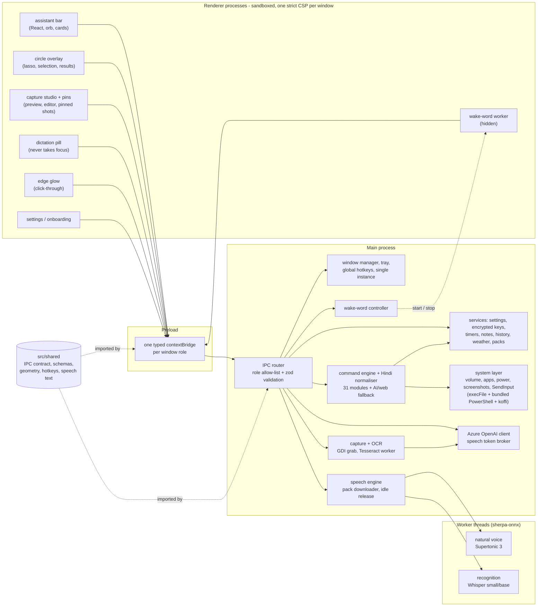

- Windows are **created hidden at start-up** (the Capture Studio, pins and dictation pill are created on demand) and only
  shown when needed, which is why the bar appears in tens of milliseconds.
- Every IPC channel is declared once in `src/shared/ipc`, limited to the windows that need it, and validated in the main
  process; renderers never get Node, the file system or your keys.
- A command is a small module (`defineCommand`) with a scoring matcher and a `run` that returns UI cards; all services are
  injected, so the commands are unit-tested without Electron. Hindi and Hinglish are normalised into those English
  forms first, and replies are localised afterwards.
- The speech models live in **worker threads** that the main process starts when you talk and terminates after idle, which
  returns all of their memory (about 1 GB) to Windows.

## Development

```powershell
git clone https://github.com/snowjug/Beekeeper.git
cd Beekeeper
npm ci
npm run dev        # electron-vite with hot reload
```

| Script                       | Purpose                                                                                        |
| ---------------------------- | ---------------------------------------------------------------------------------------------- |
| `npm run typecheck`          | `tsc` for the main, renderer and end-to-end projects (strict, no `any` leaks)                  |
| `npm run lint`               | ESLint (type-aware, bans `eval` / `new Function` / `exec`) and Prettier                        |
| `npm test`                   | Vitest, with coverage thresholds (≥ 80 % for `src/main/commands` and `src/shared`)             |
| `npm run build` · `test:e2e` | Production build · Playwright drives the real built app                                        |
| `npm run dist`               | Installer + portable exe into `release/` (set `BEEKEEPER_BUILD_OUT` to build outside OneDrive) |
| `npm run icons`              | Regenerates all icons, tray frames and installer art from code                                 |

The unit suite has ~7,500 tests (more than 400 Hindi and Hinglish phrases and 230 English ones route through the real
command engine) and the end-to-end suite covers the tray, single instance, answers, timers, Circle to Search with a
simulated lasso and OCR, Capture Studio and pinned screenshots, dictation with real key input, settings persistence,
first-run onboarding, offline voice and the wake word with a fake microphone. An opt-in spec
(`BEEKEEPER_E2E_SPEECH=1`) downloads the real speech models and round-trips English and Hindi. See
[CONTRIBUTING.md](CONTRIBUTING.md).

**Releasing:** bump `version` in `package.json`, update [CHANGELOG.md](CHANGELOG.md), then tag and push
(`git tag v1.1.1; git push origin v1.1.1`). The [release workflow](.github/workflows/release.yml) lints, tests, builds and
publishes both executables plus `latest.yml` (which the in-app updater reads).

## Performance

Measured on the packaged 1.1 build (Windows 11, 1920×1080 at 150 % scaling, Intel Core i7-1185G7, Electron 45):

| Budget                             | Target   | Measured                                                                  |
| ---------------------------------- | -------- | ------------------------------------------------------------------------- |
| Cold start to tray ready           | < 2.5 s  | 0.4-0.6 s (3-5 s the very first time Windows scans a fresh exe)           |
| Hotkey to assistant bar painted    | < 150 ms | ~31 ms (median)                                                           |
| Circle to Search hotkey to overlay | < 400 ms | ~100 ms (median), ~250 ms after a long idle; the screenshot 27-49 ms      |
| Idle memory, all windows hidden    | < 250 MB | 198-212 MB (Task Manager "Memory", 4 processes), models released          |
| Idle CPU, wake word off            | ~0 %     | 0.07-0.13 %                                                               |
| Idle CPU, wake word on (opt-in)    | < 3 %    | 1.6-3.2 % (measured on 1.0.0; about 380 MB, the voice model stays loaded) |

The speech models are the heavy part, which is why they are loaded on demand and released after three idle minutes
(`BEEKEEPER_SPEECH_IDLE_MS` changes that):

| Speech model               | When it is loaded                         | Extra memory | Time                                                                                      |
| -------------------------- | ----------------------------------------- | ------------ | ----------------------------------------------------------------------------------------- |
| Natural voice (Supertonic) | when the bar opens with spoken replies on | ~270 MB      | first reply after a pause ~4 s (load + speak), then ~0.8 s for a short Hindi line         |
| Whisper small              | as soon as you start listening            | ~950 MB      | ~9 s to load, so the first request after a pause is slower; then ~2 s for a short request |

After the idle release the process tree is back to ~215 MB. The figures come from a laptop CPU without a GPU; a faster
machine is quicker, and Whisper base (Settings > Voice) is smaller and faster but less accurate, especially for Hindi.

The full measurement log is in [BUILD_LOG.md](BUILD_LOG.md).

## Troubleshooting

- **"Microphone blocked" or no sound level** - Windows Settings > Privacy & security > Microphone: allow _Let desktop apps
  access your microphone_. Settings > Voice > _Test microphone_ shows a live level; pick the right device there.
- **A hotkey does nothing** - another program owns that combination. Settings > Hotkeys shows which one failed and offers a
  free alternative.
- **SmartScreen blocks the installer** - the build is unsigned: _More info > Run anyway_.
- **Voice model download fails** - it resumes where it stopped; press _Resume_ or _Retry_ in the tour or Settings > Voice. Typing,
  Capture Studio and Circle to Search never need it. Downloads are checked against pinned SHA-256 sums; if Windows reports
  that it cannot unpack the voice, make sure `C:\Windows\System32\tar.exe` exists (Windows 10 1803 and later ship it).
- **Beekeeper does not understand me** - open Settings > Voice and pick _Accurate recognition (Whisper small)_ and the language
  you speak (or _Auto_). The first request after a pause takes a couple of seconds while the models load. Brand names can still
  be misheard ("open crow" for Chrome): speak slowly or type them.
- **The voice sounds like the old Windows voice** - the natural voice is not downloaded yet (or failed to start), so Beekeeper
  fell back to Windows. Settings > Voice shows its status and a _Download_ button.
- **Dictation types nothing** - Windows blocks typing into apps that run as administrator; the text is copied instead, press
  `Ctrl+V`. Start dictation with the cursor already in the target field.
- **Circle to Search shows a black area** - protected video (DRM) is not capturable by any screenshot tool.
- **Building inside OneDrive fails with EPERM/EBUSY** - OneDrive locks files; run `$env:BEEKEEPER_BUILD_OUT =
"$env:LOCALAPPDATA\beekeeper-build"` before `npm run dist` and copy the exes back.
- **Logs** - `%APPDATA%\Beekeeper\logs` (Settings > Privacy > _Open logs folder_). Keys are redacted.

## Roadmap

- Code-signed releases (no SmartScreen warning) and winget / Microsoft Store packages
- A Hindi-trained wake word and more recognition and OCR languages (Tamil, Bengali, Marathi ...)
- Plug-in commands and a small automation recipe format
- Optional on-device language model for open-ended questions
- Custom wake phrase and per-app command packs

## License

[MIT](LICENSE) © 2026 Atharv Shukla. Third-party components keep their own licenses and are listed in the app under
Settings > About: Electron, React, Vosk, Tesseract, Open-Meteo data, [sherpa-onnx](https://github.com/k2-fsa/sherpa-onnx)
(Apache-2.0), OpenAI Whisper (MIT) and the Supertonic 3 voice model (OpenRAIL-M, Supertone Inc.).
