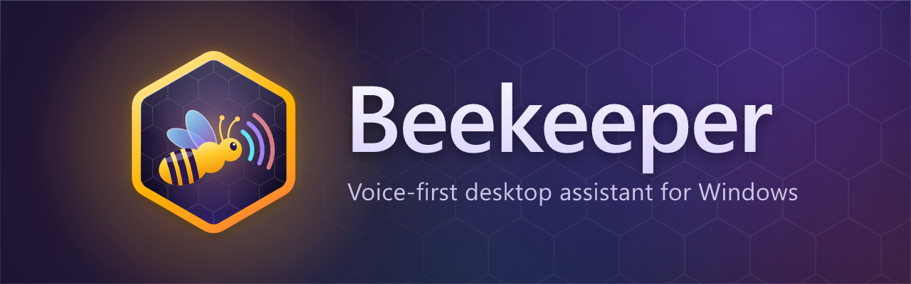
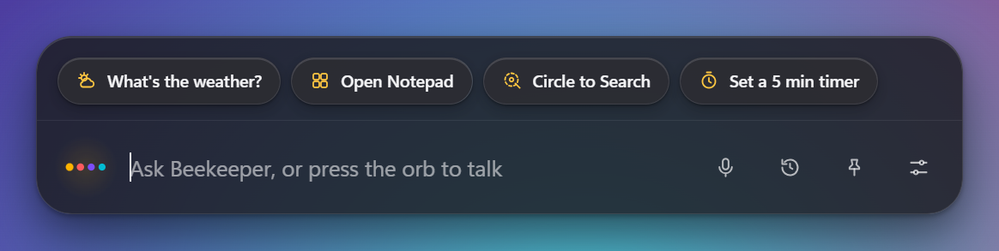
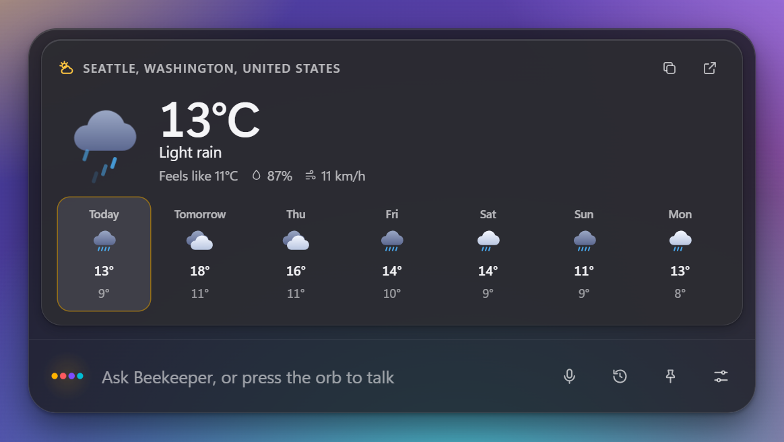
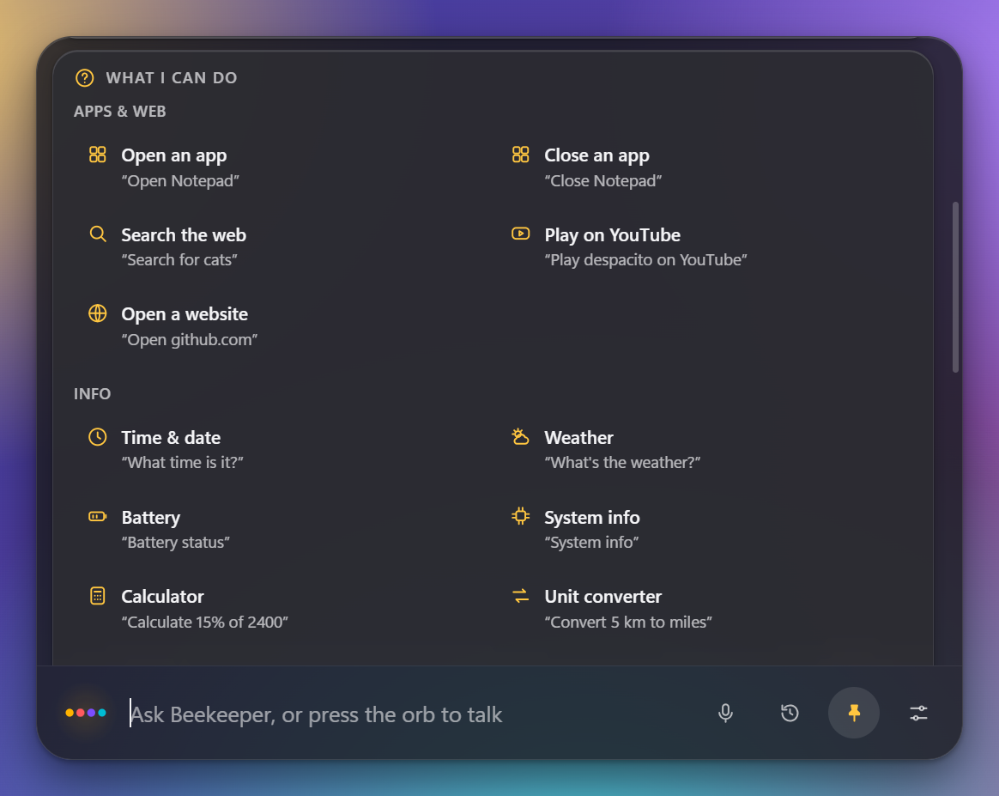
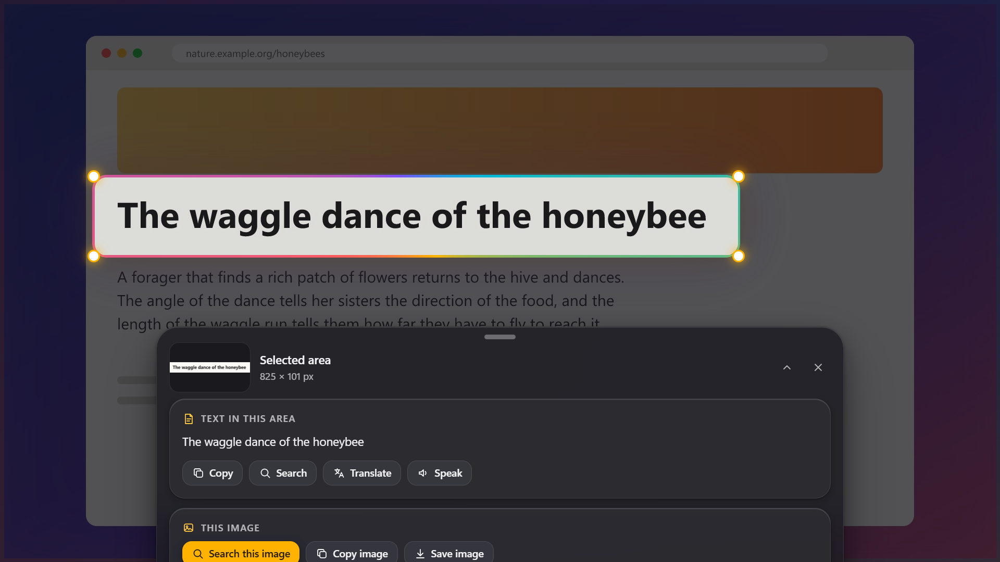
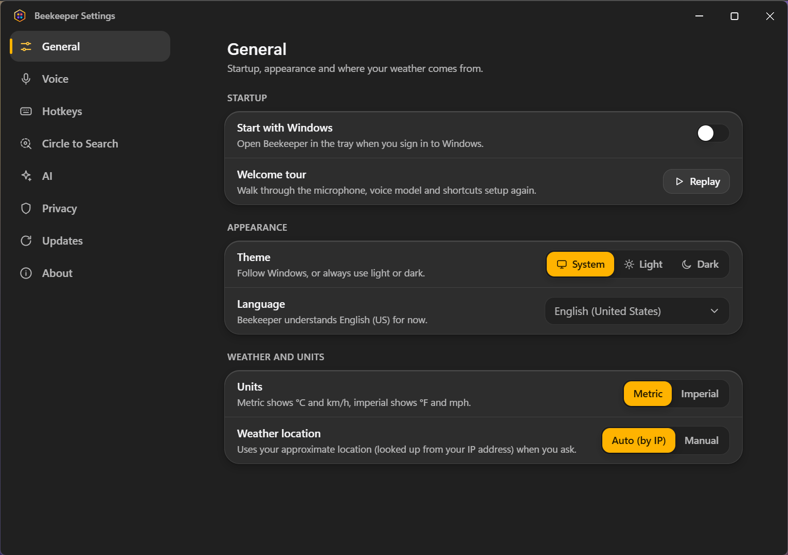
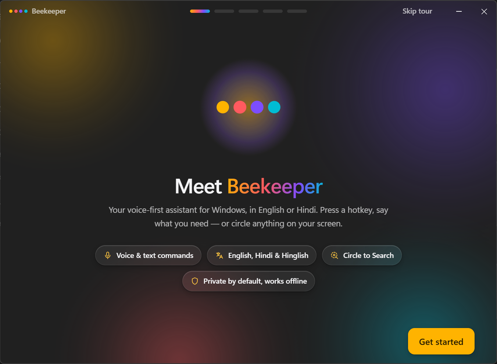
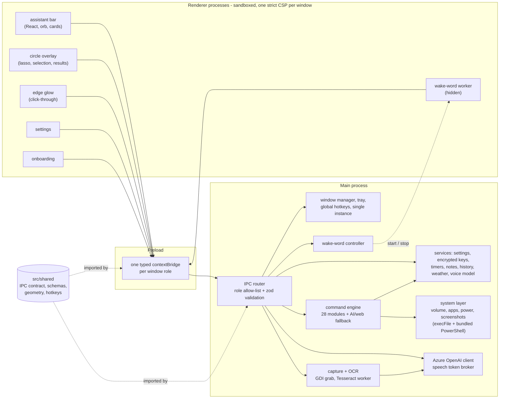

<div align="center">



# Beekeeper

**A voice-first desktop assistant for Windows with Circle to Search.**<br>
Press a hotkey, say what you need - or circle anything on your screen. Private by default, works offline.

[](https://github.com/snowjug/Beekeeper/actions/workflows/ci.yml)
[](https://github.com/snowjug/Beekeeper/releases/latest)
[](LICENSE)


### [⬇ Download for Windows](https://github.com/snowjug/Beekeeper/releases/latest)

<sub>Installer (`Beekeeper-Setup-1.0.0.exe`) or portable (`Beekeeper-Portable-1.0.0.exe`) · 64-bit · unsigned, see [SmartScreen](#install)</sub>

</div>

<br>

<p align="center">
  
</p>

## Highlights

- **One hotkey, one bar.** `Ctrl+Shift+Space` springs a glass assistant bar up on the display you are working on, in
  about 40 ms. Type, or just talk.
- **Voice that stays on your PC.** Offline speech recognition (Vosk) with live transcript, a glowing click-through screen
  edge while it listens, spoken replies, push-to-talk and an optional **"Hey Beekeeper"** wake word.
- **29 commands** for apps, the web, information, productivity and Windows itself - with typo-tolerant, synonym-aware
  phrasing and follow-ups ("what about tomorrow?").
- **Circle to Search for your whole desktop.** `Alt+Shift+C` freezes the screen, you draw a glowing lasso around anything,
  and Beekeeper reads it (offline OCR) and offers copy, search, translate, speak and more.
- **Premium, calm UI.** Spring physics, Mica, 60 fps transform-only animation, full keyboard navigation, screen-reader
  announcements and a reduced-motion mode.
- **Private by default.** No account, no telemetry, nothing leaves your PC unless you ask for something that needs the
  internet (weather, a definition) or switch on the optional Azure features. See [PRIVACY.md](PRIVACY.md).

<table>
  <tr>
    <td width="50%"><br><sub><b>Weather</b> - live card with a 7-day forecast and animated icons.</sub></td>
    <td width="50%"><br><sub><b>"What can you do?"</b> - every command with an example you can click.</sub></td>
  </tr>
</table>

### Circle to Search

<p align="center">
  
</p>

Draw a lasso (it glows and morphs into a selection box), **tap** a word, **double-tap** a line, hold **Shift** to drag a
rectangle, or use the keyboard (`Enter` starts a selection, arrow keys move it, `Shift` + arrows resize it). The text is recognised on your PC; links, e-mail addresses, phone
numbers, dates and maths get their own actions, and the picture can be searched, copied or saved. With Azure OpenAI
configured you can also **ask about the selected image**. `Esc` cleans everything up.

### Settings and first run

<table>
  <tr>
    <td width="50%"><br><sub>Settings apply instantly - there is no Save button.</sub></td>
    <td width="50%"><br><sub>A five-step first-run tour: microphone, voice model, hotkeys, wake word.</sub></td>
  </tr>
</table>

## Hotkeys

| Hotkey                        | What it does                                                                                              |
| ----------------------------- | --------------------------------------------------------------------------------------------------------- |
| `Ctrl` `Shift` `Space`        | Open the assistant bar and start listening (press again to close). With push-to-talk on, hold it to talk. |
| `Alt` `Shift` `C`             | Circle to Search on the display under the mouse.                                                          |
| `Enter` · `Up` / `Down`       | Send the text · recall earlier requests.                                                                  |
| `Esc`                         | Stop speaking / listening, close the bar, leave Circle to Search.                                         |
| Wake word **"Hey Beekeeper"** | Off by default. Turn it on in Settings > Voice (needs the voice model).                                   |

Both global hotkeys can be changed in **Settings > Hotkeys**. If another program already owns a combination, Beekeeper says
so and suggests a free alternative.

## What you can say

Type or speak. Anything that is not a command goes to your AI (if you configured Azure OpenAI) or opens a web search.

| #   | Command                     | Try saying                                                                    |
| --- | --------------------------- | ----------------------------------------------------------------------------- |
| 1   | Open an app                 | "Open Notepad" · "Launch VS Code" · "Start Spotify" · "Open task manager"     |
| 2   | Close an app                | "Close Notepad" · "Quit Chrome" (graceful; asks before forcing)               |
| 3   | Search the web              | "Search for cats" · "Google best pizza" · "Bing weather in Paris"             |
| 4   | Play on YouTube             | "Play despacito on YouTube" · "YouTube lofi beats"                            |
| 5   | Open a website              | "Open github.com" · "Go to example.org"                                       |
| 6   | Time & date                 | "What time is it?" · "What's the date?" · "What time is it in Tokyo?"         |
| 7   | Weather                     | "Weather in Paris" · "Will it rain tomorrow?" (7-day animated card)           |
| 8   | Battery                     | "Battery status" · "Is my laptop charging?"                                   |
| 9   | System info                 | "System info" · "How much RAM do I have?" · "How long has my PC been on?"     |
| 10  | Calculator                  | "Calculate 15% of 2400" · "Square root of 144" · "2^8" (safe parser)          |
| 11  | Unit converter              | "Convert 5 km to miles" · "100°F to celsius" · "10 pounds in kg"              |
| 12  | Dictionary                  | "Define serendipity" · "What does ephemeral mean?"                            |
| 13  | Timers                      | "Set a timer for 5 minutes" · "Cancel my timer" (several at once)             |
| 14  | Reminders                   | "Remind me in 10 minutes to call mom" · "Remind me at 3:30 pm to ..."         |
| 15  | Alarms                      | "Set an alarm for 7 am" · "Wake me up at 6:30"                                |
| 16  | Notes                       | "Take a note buy milk" · "Show my notes" · "Delete last note"                 |
| 17  | Copy that                   | "Copy that" (copies the last answer)                                          |
| 18  | Volume                      | "Volume up" · "Mute" · "Set volume to 40%"                                    |
| 19  | Brightness                  | "Brightness down" · "Set brightness to 70%"                                   |
| 20  | Screenshot                  | "Take a screenshot" (saved to `Pictures\Beekeeper`, with an Open button)      |
| 21  | Lock                        | "Lock my PC"                                                                  |
| 22  | Windows settings            | "Open Wi-Fi settings" · "Bluetooth settings" · "Sound settings"               |
| 23  | Empty the Recycle Bin       | "Empty the recycle bin" (asks first)                                          |
| 24  | Shut down / restart / sleep | "Restart" · "Shut down" · "Sleep" (always asks, with a 10 s cancel countdown) |
| 25  | Dark mode                   | "Toggle dark mode" · "Switch to dark mode"                                    |
| 26  | Circle to Search            | "Circle to Search" · "Search my screen"                                       |
| 27  | Settings & help             | "Open settings" · "What can you do?"                                          |
| 28  | Stop                        | "Stop" · "Never mind" · "Cancel"                                              |
| 29  | Anything else               | Streaming answer from **Azure OpenAI** if configured, otherwise a web search  |

Reminders and timers survive a restart and fire if they are still due.

## Install

1. Open the [latest release](https://github.com/snowjug/Beekeeper/releases/latest).
2. Download **`Beekeeper-Setup-1.0.0.exe`** (installer: Start menu and desktop shortcuts, updates itself) or
   **`Beekeeper-Portable-1.0.0.exe`** (runs from any folder, never updates itself).
3. Run it. The builds are **not code signed**, so Windows SmartScreen may say "Windows protected your PC":
   click **More info → Run anyway**. You can compare the file with the release page first.
4. Beekeeper lives in the tray (the honeycomb icon). The first-run tour helps you allow the microphone and download the
   40 MB offline voice model; typing and Circle to Search work without it.

Requires 64-bit Windows 10 (1809) or Windows 11. Mica backgrounds need Windows 11 22H2 or newer; older builds get a
frosted-glass fallback.

## Optional: Azure Speech and Azure OpenAI

Everything works offline. If you want neural speech or open-ended AI answers, add your own Azure resources:

1. **Azure AI Speech** - create a _Speech_ resource in the Azure portal, then copy **Key 1** and the **Region** (for example
   `eastus`) from _Keys and Endpoint_.
2. **Azure OpenAI** - create an Azure OpenAI resource, deploy a chat model (a vision-capable one such as `gpt-4o` also enables
   "Ask about this image"), and note the **endpoint** (`https://<name>.openai.azure.com`), the **deployment name** and a key.
3. In Beekeeper open **Settings > AI**. Under _Azure Speech_ switch it on, enter the region and key and press
   **Test connection**. Do the same under _Azure OpenAI_ (endpoint, deployment name, key).
4. In **Settings > Voice** choose _Azure_ as the recognition engine and/or the voice engine.

Keys are stored **encrypted with Windows DPAPI** (Electron `safeStorage`), never shown again (only a masked hint), never
logged and never sent to a window. Any failure falls back to the offline engines. Developers can also pre-fill the values
from `%APPDATA%\Beekeeper\.env` (see [`.env.example`](.env.example)); keys typed into Settings take precedence.

## Privacy

Offline by default, **no telemetry**, no account. Voice is recognised on your PC and never written to disk; screenshots
for Circle to Search live in memory only. The only network calls are the ones you trigger - weather (Open-Meteo),
definitions (dictionaryapi.dev), the one-time voice-model download, update checks (GitHub) and, if you enable them, your
own Azure resources. The full table is in [PRIVACY.md](PRIVACY.md); security design and reporting in
[SECURITY.md](SECURITY.md).

## Architecture



- Windows are **created hidden at start-up** and only shown on demand, which is why the bar appears in tens of milliseconds.
- Every IPC channel is declared once in `src/shared/ipc`, limited to the windows that need it, and validated in the main
  process; renderers never get Node, the file system or your keys.
- A command is a small module (`defineCommand`) with a scoring matcher and a `run` that returns UI cards; all services are
  injected, so the 28 commands are unit-tested without Electron.

## Development

```powershell
git clone https://github.com/snowjug/Beekeeper.git
cd Beekeeper
npm ci
npm run dev        # electron-vite with hot reload
```

| Script                       | Purpose                                                                                        |
| ---------------------------- | ---------------------------------------------------------------------------------------------- |
| `npm run typecheck`          | `tsc` for the main, renderer and end-to-end projects (strict, no `any` leaks)                  |
| `npm run lint`               | ESLint (type-aware, bans `eval` / `new Function` / `exec`) and Prettier                        |
| `npm test`                   | Vitest, with coverage thresholds (≥ 80 % for `src/main/commands` and `src/shared`)             |
| `npm run build` · `test:e2e` | Production build · Playwright drives the real built app                                        |
| `npm run dist`               | Installer + portable exe into `release/` (set `BEEKEEPER_BUILD_OUT` to build outside OneDrive) |
| `npm run icons`              | Regenerates all icons, tray frames and installer art from code                                 |

The unit suite has ~4,900 tests (230 phrases route through the real command engine) and the end-to-end suite covers the
tray, single instance, answers, timers, Circle to Search with a simulated lasso and OCR, settings persistence, first-run
onboarding, offline voice and the wake word with a fake microphone. See [CONTRIBUTING.md](CONTRIBUTING.md).

**Releasing:** bump `version` in `package.json`, update [CHANGELOG.md](CHANGELOG.md), then tag and push
(`git tag v1.0.0; git push origin v1.0.0`). The [release workflow](.github/workflows/release.yml) lints, tests, builds and
publishes both executables plus `latest.yml` (which the in-app updater reads).

## Performance

Measured on the packaged build (Windows 11, 1920×1080 at 150 % scaling, Electron 45):

| Budget                             | Target   | Measured                            |
| ---------------------------------- | -------- | ----------------------------------- |
| Cold start to tray ready           | < 2.5 s  | 0.7-0.9 s                           |
| Hotkey to assistant bar painted    | < 150 ms | ~40 ms (median)                     |
| Circle to Search hotkey to overlay | < 400 ms | ~90 ms (median), screen grab ~40 ms |
| Idle memory, all windows hidden    | < 250 MB | ~190 MB working set (private)       |
| Idle CPU, wake word off            | ~0 %     | 0-0.1 %                             |

The full measurement log is in [BUILD_LOG.md](BUILD_LOG.md).

## Troubleshooting

- **"Microphone blocked" or no sound level** - Windows Settings > Privacy & security > Microphone: allow _Let desktop apps
  access your microphone_. Settings > Voice > _Test microphone_ shows a live level; pick the right device there.
- **A hotkey does nothing** - another program owns that combination. Settings > Hotkeys shows which one failed and offers a
  free alternative.
- **SmartScreen blocks the installer** - the build is unsigned: _More info > Run anyway_.
- **Voice model download fails** - it resumes where it stopped; press _Resume_ or _Retry_ in the tour or Settings > Voice. Typing
  and Circle to Search never need it.
- **Circle to Search shows a black area** - protected video (DRM) is not capturable by any screenshot tool.
- **Building inside OneDrive fails with EPERM/EBUSY** - OneDrive locks files; run `$env:BEEKEEPER_BUILD_OUT =
"$env:LOCALAPPDATA\beekeeper-build"` before `npm run dist` and copy the exes back.
- **Logs** - `%APPDATA%\Beekeeper\logs` (Settings > Privacy > _Open logs folder_). Keys are redacted.

## Roadmap

- Code-signed releases (no SmartScreen warning) and winget / Microsoft Store packages
- More recognition and OCR languages beyond English (US)
- Plug-in commands and a small automation recipe format
- Optional on-device language model for open-ended questions
- Custom wake phrase and per-app command packs

## License

[MIT](LICENSE) © 2026 Atharv Shukla. Third-party components (Electron, React, Vosk, Tesseract, Open-Meteo data and others)
keep their own licenses; they are listed in the app under Settings > About.
